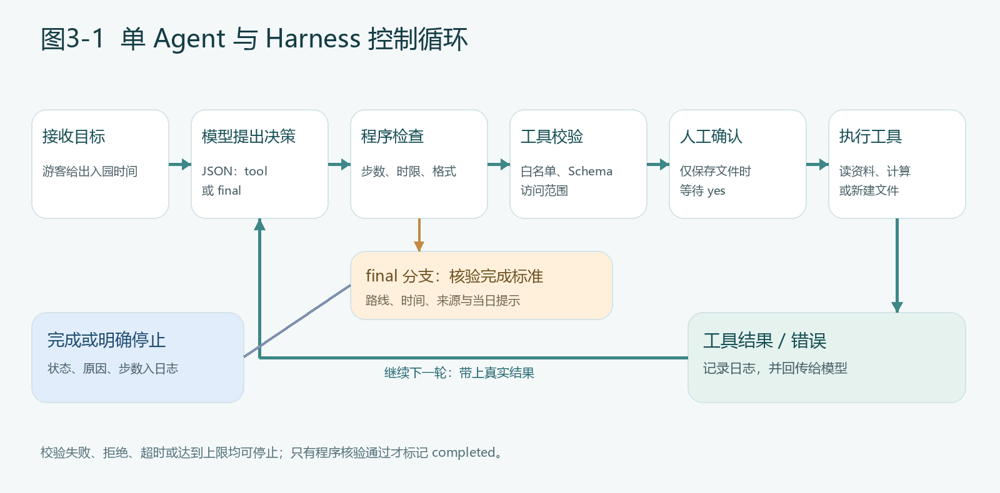
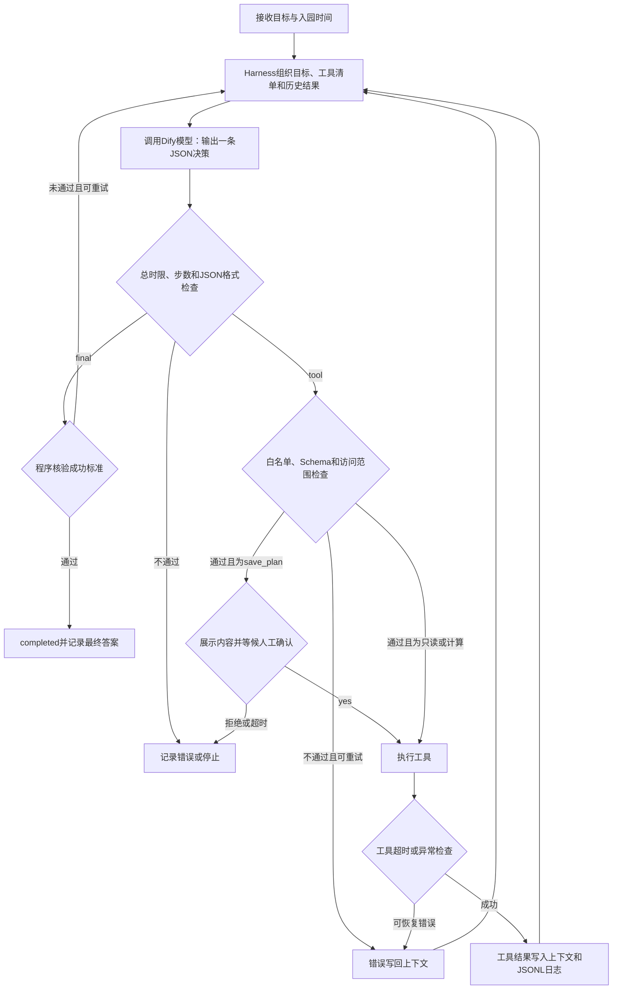
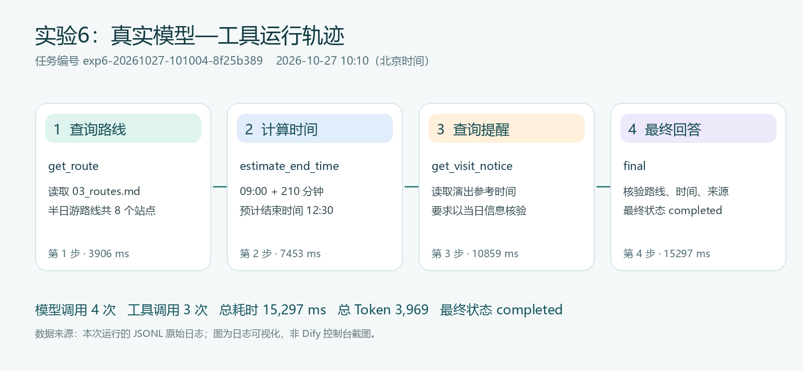
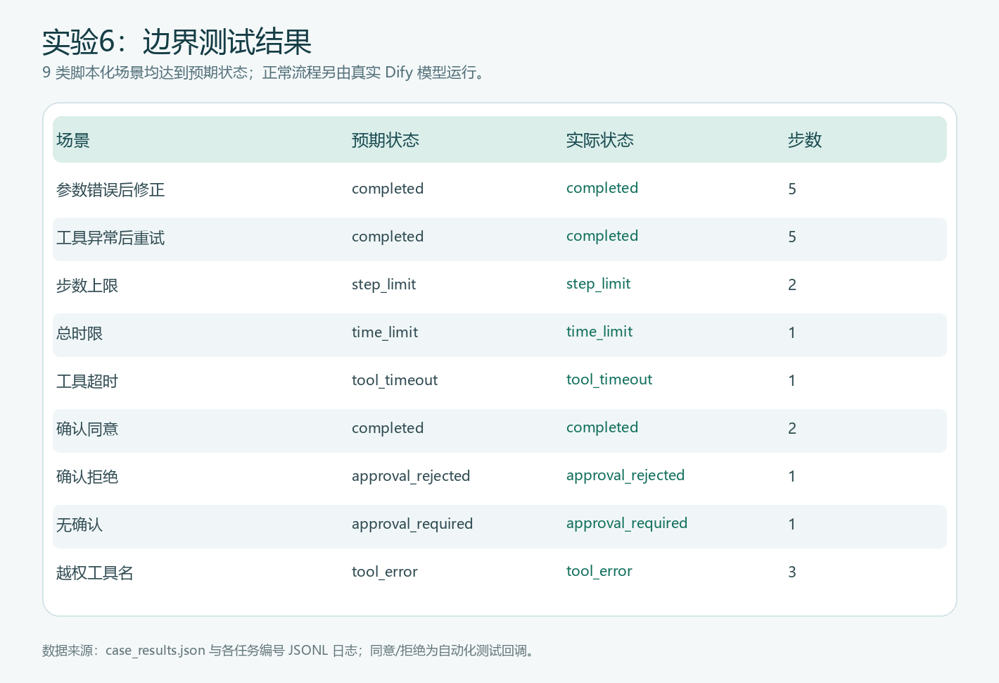

# 实验6：工具调用、Agent与Harness实现

## 学习通提交说明

- **提交平台：** 只向学习通对应的作业上传一份PDF文件。
- **文件命名：** 班级-学号-姓名-实验6-工具调用、Agent与Harness实现.pdf。
- **PDF内容：** 任务说明、工具接口、Agent、Harness、执行日志和实验小结，附仓库链接与Commit。
- **截止时间：** 以学习通作业设置为准。

## 1. 实验目的

- 掌握工具接口定义、参数验证、权限边界和结果反馈。
- 实现一个由模型根据任务和工具结果决定下一步操作、运行状态可查看且能够终止的单Agent。
- 编写运行时Harness，完成上下文组织、工具执行、结果检查、停止控制和日志记录。

## 2. 实验内容

### 2.1 任务选择与边界

- 结合个人软件选择一个范围较小、结果能够检查的任务，如查询样例数据后生成统计结果；不适合接入个人软件时，可独立完成练习。
- 列出任务目标、可用数据、工具、停止条件和成功标准，并给出一组输入及预期结果。本实验实现单Agent，由模型根据目标和工具结果决定下一步操作；说明哪些步骤由程序预设，哪些由模型决定。
- 说明哪些操作允许自动执行，哪些必须用户确认，哪些明确禁止。

### 2.2 工具接口与参数约束

- 实现至少2个可实际运行的工具，如读取样例文件、查询数据或执行统计计算，说明名称、用途、输入字段、类型、必填项、返回结果和错误信息。输入格式及字段约束也称Schema。
- 建立允许调用的工具列表，执行前由程序检查工具名称、参数和访问范围，例如数值范围、允许的文件目录或可访问的数据；不能直接执行模型生成的任意函数名或命令。
- 说明工具的最长等待时间、是否修改数据，以及重复调用是否会产生重复修改；在接入Agent前，直接测试至少一次正确参数和一次错误参数。

### 2.3 Agent循环与状态

- 绘制“接收目标—模型提出调用请求—程序检查并执行工具—回传工具结果—模型继续或给出最终回答”的循环图，标出参数校验、人工确认和停止检查的位置。
- 接入支持工具调用的模型接口，或约定可由程序解析的JSON调用格式，实际运行模型与工具之间的循环。模型提出工具名称和参数，程序负责执行；将调用请求和对应工具结果按接口要求加入后续上下文，不能只把结果打印出来。
- 设置最大执行步数、模型与工具调用超时、总运行时限及重试上限，说明一步如何计数，并由程序执行限制。模型给出最终回答后，还应检查结果是否满足2.1的成功标准，不能仅凭模型声称完成就判定成功。

### 2.4 运行时Harness设计与实现

- 将组织模型与工具运行的外围程序作为本实验的运行时Harness，说明任务输入、上下文、执行、结果检查和日志分别由哪些函数或模块负责，不要求拆成多个独立服务。
- 实现模型调用、工具分发、参数与权限检查、结果回传和停止控制；保留当前任务需要的输入、调用记录及工具结果。关键限制必须由程序执行，不能只写在提示词中。
- 工具失败或结果不符合要求时，将错误信息反馈给模型进行有限次修正，或结束任务并说明原因。可以使用开发框架或自行编写代码，但须说明实际控制流程，不要求多Agent或复杂框架。

### 2.5 失败处理与可观测性

- 为每次运行设置任务编号，记录时间、调用的工具与参数摘要、工具结果、错误类型、执行步数、耗时和最终状态；密钥和个人信息须遮挡或省略。
- 处理参数错误、工具异常、超时和达到步数上限等情况，返回明确状态和原因。超时可能只是停止等待，不代表后台工具已停止，应说明实际取消能力；可能修改数据的调用状态不明时，先核对执行结果，不得直接重试。
- 对需要确认的操作，在执行前展示操作内容与影响，由用户明确同意后执行；拒绝或等待超时则不执行。

### 2.6 测试与结果分析

- 至少测试5类情况：正常完成、参数错误、工具异常、达到步数或时间限制、人工确认。其中人工确认分别检查同意与拒绝；异常与边界情况可模拟触发，正常流程必须实际调用模型和工具。
- 用表格记录输入、预期行为、实际结果和判断依据，检查任务是否完成、错误是否正确反馈、停止与确认规则是否生效；未符合预期时，分析问题出在模型决策、参数、工具、检查规则还是控制流程。
- 说明Agent及运行时Harness是否用于个人软件，以及当前局限和改进计划；在个人GitHub/Gitee仓库保存工具、Agent、Harness、测试代码和运行说明，报告注明路径及对应Commit。

## 3. 操作记录

本实验沿用已有个人软件“灵境AI——AI景区数字人导游系统”，不另建应用。实验日期为 **2026 年 10 月 27 日**。项目仓库：[CJY322/ai-scenic-guide](https://github.com/CJY322/ai-scenic-guide)。实现代码位于 `services/api-server/scripts/experiment6_agent.py`，测试与运行说明分别位于 `services/api-server/scripts/experiment6_cases.py`、`services/api-server/tests/test_experiment6_agent.py` 和 `docs/experiment6_agent.md`。本节所有代码、图和日志均编号，并在其后说明对应的实验要求。

### 3.1 对应 2.1：任务选择与边界

#### 3.1.1 任务、数据和预期结果

选定一个可检查的游客任务：**根据游客给出的入园时间，从现有灵山胜境资料中推荐半日游路线，计算预计结束时间，并提示演出场次需要以当日官方信息核对。** 该任务直接服务于项目中的路线问答。数据只取仓库内两份 UTF-8 Markdown：`data/knowledge/lingshan/03_routes.md` 的“半日游推荐”段和 `04_service_tips.md` 的“演出与开放信息”段。它们来自项目已有的示范景区资料，不包含真实游客个人信息。

| 项目 | 本次设置 |
| --- | --- |
| 输入样例 | `09:00` 入园，要求半日路线、预计结束时间和演出提醒 |
| 可用工具 | `get_route`、`get_visit_notice`、`estimate_end_time`；另提供需确认的 `save_plan` |
| 预期结果 | 南门入园 → 灵山大照壁 → 五明桥 → 九龙灌浴 → 祥符禅寺 → 灵山大佛 → 灵山梵宫 → 出口；资料为 3—4 小时，取中值 210 分钟，预计 `12:30` 结束 |
| 成功标准 | 程序日志中确有路线、演出提醒和时间计算三个工具结果；最终文本包含路线起点、梵宫、`12:30`、`03_routes.md` 和当日核验提醒 |
| 停止条件 | 通过成功检查；或达到步数、总时限、模型/工具超时、重试上限、确认拒绝或确认超时 |

程序预设了允许访问的资料目录、工具 Schema、时间算法、完成检查和各项上限。**模型决定**每一轮是调用哪个允许的工具、传入什么参数、是否继续调用以及何时提出最终回答；程序只在模型提议后验证和执行。正常实测中模型先读路线、再计算结束时间、再读演出提醒，最后回答。预计结束时间只是行程估算，不能当作真实演出或闭园时间。

#### 3.1.2 自动权限与禁止事项

允许自动执行读取固定知识文件和计算时间。`save_plan` 只允许在本项目 `services/api-server/outputs/experiment6/plans/` 中**新建**文本文件，执行前必须展示文件名、完整内容和影响，等待用户输入 `yes`。输入 `no`、其他内容或 30 秒内未回答均不写入。禁止模型指定任意文件路径、读取别的目录、覆盖已有文件、运行 shell 命令、购票、预约或对外发送消息。API Key 只由本机 `.env` 读取，不写入提示词、报告或日志。

### 3.2 对应 2.2：工具接口与参数约束

#### 3.2.1 工具清单与 Schema

实现采用 `ToolRegistry` 的固定白名单，所有参数由 Pydantic 严格模式检查，额外字段直接拒绝。模型输出的字符串不会被当作 Python 函数名动态调用；只可命中白名单中的方法。工具接口如下。

| 工具 | 输入字段：类型、必填和约束 | 返回结果 | 错误/权限 | 最长等待、修改与重复调用 |
| --- | --- | --- | --- | --- |
| `get_route` | `route_type: Literal["half_day","family"]`，必填 | 文档名、路线标题、站点数组、分钟数与取值说明 | 无效路线报 `INVALID_ARGUMENTS`；固定读取 `03_routes.md` | 2 秒；只读；重复调用无修改 |
| `get_visit_notice` | `kind: Literal["performance","accessibility"]`，必填 | 文档名、提醒类别和原文 | 无效类别报 `INVALID_ARGUMENTS`；固定读取 `04_service_tips.md` | 2 秒；只读；重复调用无修改 |
| `estimate_end_time` | `start_time: HH:MM`，`duration_minutes: int`，均必填；分钟须为 60—480 | 开始时间、分钟数、结束时间、是否跨日 | 格式或范围错误报 `INVALID_ARGUMENTS` | 2 秒；纯计算；重复调用结果相同 |
| `save_plan` | `filename: 安全的 .txt 文件名`、`content: 10—2000 字符`，均必填 | 实际保存路径和字节数 | 先确认；非法文件名拒绝；已存在报 `ALREADY_EXISTS`；无确认不执行 | 2 秒；只新建、不覆盖；重复同名写入被拒绝 |

**代码3-1：参数验证和白名单调用的关键规则。** 原文件保留完整实现，以下摘录说明由程序强制执行的约束。

```python
TOOL_SCHEMAS = {
    "get_route": RouteArgs,
    "get_visit_notice": NoticeArgs,
    "estimate_end_time": EndTimeArgs,
    "save_plan": SaveArgs,
}

def validate(self, name, arguments):
    schema = TOOL_SCHEMAS.get(name)
    if schema is None:
        raise ToolFailure("TOOL_NOT_ALLOWED", "tool is not in the allowlist")
    return schema.model_validate(arguments)
```

其中 `StrictArgs` 设置 `extra="forbid"` 和 `strict=True`；`EndTimeArgs` 检查 24 小时制时间；`SaveArgs` 只接受无目录分隔符的 `.txt` 文件名，并阻止 Windows 保留设备名。`save_plan` 用排他模式 `open("x")` 新建文件，因此同名重试不会覆盖已有内容。

#### 3.2.2 接入 Agent 前的直接测试

**日志3-1：工具正常参数与错误参数测试摘要。** 这些测试由 `tests/test_experiment6_agent.py` 直接调用工具或参数验证函数。

```text
get_route({"route_type":"half_day"})
  → source=03_routes.md, first_stop=南门入园, duration_minutes=210
estimate_end_time({"start_time":"09:00","duration_minutes":210})
  → end_time=12:30
estimate_end_time({"start_time":"9am","duration_minutes":210})
  → INVALID_ARGUMENTS
estimate_end_time({"start_time":"09:00","duration_minutes":999})
  → INVALID_ARGUMENTS
run_shell({"command":"echo hi"})
  → TOOL_NOT_ALLOWED
```

上述正确输入得到与资料及算术一致的结果；错误输入在执行前被拦截。`save_plan` 的非法 `../escape.txt` 文件名也被 Schema 拒绝；同名文件第二次写入返回 `ALREADY_EXISTS`。自动化测试结果为 **5 passed**。

### 3.3 对应 2.3：Agent 循环与状态

#### 3.3.1 循环图

**图3-1：单 Agent 的模型—工具—反馈循环。** 程序检查包含步数、格式、白名单和参数；“人工确认”只在提议 `save_plan` 时出现。



下列 Mermaid 源码便于在支持 Mermaid 的 Markdown 编辑器中复现该循环图；图像版见上图。



#### 3.3.2 模型调用格式与上下文回传

使用项目已发布的 Dify 直接模型应用。该 Chat App 不依赖平台原生 function calling；本实验约定模型每次只返回一个可解析 JSON 对象。工具请求格式为 `{"action":"tool","name":"get_route","arguments":{"route_type":"half_day"}}`，结束格式为 `{"action":"final","answer":"..."}`。`DifyModel.complete()` 将任务、工具清单和此前的**每次工具调用、真实返回值或错误**组织成下一轮输入，再调用 `/v1/chat-messages`。因此后续模型能依据先前工具结果继续决策，而不只是把工具结果打印到控制台。

**代码3-2：状态更新的核心逻辑摘录。** `steps += 1` 位于每次模型决策前，因此有效、无效和最终决策均计一步。

```python
steps += 1
raw, metadata = model.complete(_prompt(task, transcript), model_timeout)
decision = parse_decision(raw)
checked = registry.validate(decision["name"], decision["arguments"])
result = registry.execute(decision["name"], checked)
transcript.append({"tool_call": decision, "tool_result": result})
```

完整代码还包括确认、工具超时、异常和最终结果检查。默认限制：最多 **6 步**，单次模型请求 **30 秒**，单次工具等待 **2 秒**，任务总时限 **120 秒**，可恢复错误最多 **2 次**，交互确认等待 **30 秒**。这些数值由 `Limits` 和 `Harness.run()` 执行，而不只写在提示词里。

#### 3.3.3 真实模型运行与结果核验

**日志3-2：真实模型与工具循环摘要。** 执行命令为 `python scripts/experiment6_agent.py --start-time 09:00`，任务编号 `exp6-20261027-101004-8f25b389`，完整 JSONL 在 `services/api-server/outputs/experiment6/exp6-20261027-101004-8f25b389.jsonl`。

| 步 | 模型提出的决策 | 程序执行与回传 | 判定 |
| ---: | --- | --- | --- |
| 1 | `get_route({"route_type":"half_day"})` | 返回 `03_routes.md` 的 8 个站点及 `210` 分钟 | 白名单与 Schema 通过 |
| 2 | `estimate_end_time({"start_time":"09:00","duration_minutes":210})` | 返回 `end_time="12:30"` | 计算使用上一步真实分钟数 |
| 3 | `get_visit_notice({"kind":"performance"})` | 返回 `04_service_tips.md` 的参考演出时间与当日核验规则 | 资料已回传模型 |
| 4 | `final` | 生成半日路线、预计 12:30 结束、两份资料名和官方当日核验提醒 | `_success()` 检查通过 |

本轮真实云端模型调用 **4 次**、工具调用 **3 次**，总耗时 **15,297 ms**；Dify `usage` 合计 **3,969 Token**，本轮接口返回费用 `0 USD`。最终状态为 `completed`。最终回答摘录：“09:00 从南门入园，依次游览灵山大照壁—五明桥—九龙灌浴—祥符禅寺—灵山大佛—灵山梵宫，预计 12:30 结束……请务必以景区官方小程序、当日广播、现场公告及工作人员说明为准。”程序实际检查了路线和时间，不以模型的 `final` 声明代替完成判定。



**图3-2：** 根据上述 JSONL 原始日志自动绘制的四步轨迹，显示各步累计耗时、工具顺序与最终状态；原始记录可按任务编号逐行核对。

### 3.4 对应 2.4：运行时 Harness

#### 3.4.1 模块职责与控制流程

| 阶段 | 函数或类 | 具体职责 |
| --- | --- | --- |
| 任务输入 | `Task`、命令行 `main()` | 接收目标、入园时间和是否要求保存 |
| 上下文组织 | `Harness._prompt()` | 写入任务、工具说明、此前调用与工具结果 |
| 模型调用 | `DifyModel.complete()` | 发送阻塞式 Dify 请求，取回答与 Token 用量；Key 仅本机读取 |
| 决策解析 | `parse_decision()` | 移除 `<think>` 前缀，解析单个 JSON 决策，检查字段形状 |
| 工具分发 | `ToolRegistry.validate()`、`execute()` | 校验白名单、Pydantic Schema、固定数据范围，然后执行 |
| 结果检查 | `Harness._success()` | 核验实际工具结果与最终答案是否一致 |
| 停止和错误 | `Harness.run()`、`Limits` | 执行步数、模型/工具/总时限、重试和确认规则 |
| 日志 | `Harness.run()` 内的 `event()` | 记录任务编号、时间、步骤、参数摘要、结果、错误与最终状态 |

模型不能修改上述程序规则。`get_route` 与 `get_visit_notice` 的文件路径写死在受控目录；`estimate_end_time` 仅做算术；`save_plan` 只新建受限文件。工具出错时，Harness 把带错误码的结果写回模型上下文，允许有限次修正；达到错误上限则结束任务。最终文本若漏掉来源、路线或正确计算的结束时间，程序会反馈 `final_rejected`，不把它视作成功。

**代码3-3：保存方案的人工确认与不可覆盖规则。** 终端在写入前展示文件名、完整正文和影响，只有明确 `yes` 才执行；`open("x")` 保证已有文件不会被覆盖。

```text
CONFIRM save_plan: filename=exp6_visit_plan.txt
Content to write: <模型建议的完整方案>
Effect: create one new text file under outputs/experiment6/plans;
        existing files are never overwritten.
Type yes to approve, no to reject within 30 seconds:
```

### 3.5 对应 2.5：失败处理与可观测性

每次运行生成类似 `exp6-日期-时间-随机码` 的任务编号，逐事件写入 JSONL。事件包含北京时间、步数、从任务开始的毫秒数、模型提议的工具和参数摘要、工具返回值或错误类型、最终状态。对 `save_plan.content` 只记录字符数；持久化日志会遮盖应用 Key、手机号和电子邮箱。`case_results.json` 汇总边界测试，日志文件可按任务编号回查。

**日志3-3：一条真实工具记录的字段示例。** 摘自 `exp6-20261027-101004-8f25b389.jsonl` 的第 2 步；省略无关字段。

```json
{
  "event": "tool_result",
  "step": 2,
  "tool": "estimate_end_time",
  "arguments": {"start_time": "09:00", "duration_minutes": 210},
  "result": {"start_time": "09:00", "duration_minutes": 210,
             "end_time": "12:30", "next_day": false,
             "kind": "estimate_not_live_schedule"}
}
```

参数错误返回 `INVALID_ARGUMENTS`，未知工具返回 `TOOL_NOT_ALLOWED`；工具抛异常时记 `TOOL_EXCEPTION` 并在只读工具上有限重试；等待超过上限分别返回 `MODEL_TIMEOUT`、`tool_timeout` 或 `time_limit`。工具超时**仅停止等待**，不能保证后台线程已经终止。只读工具可核对后重跑；已获确认的写入若状态不明，返回 `write_status_unknown`，先检查目标文件，不直接重复写入。确认拒绝返回 `approval_rejected`，无回答/超时返回 `approval_required`，两者均不触发写入。

### 3.6 对应 2.6：测试与结果分析

#### 3.6.1 五类以上场景的运行结果

正常场景使用上文的**真实 Dify 模型和真实工具**。异常和边界场景通过 `experiment6_cases.py` 的脚本模型注入预定决策，以验证 Harness 的控制规则；它们没有冒充云端模型实测。其结果保存在 `services/api-server/outputs/experiment6/case_results.json`，每条结果包含自己的任务编号与 JSONL 路径。提交用的可移植证据副本放在 `deliverables/实验6证据/`，含真实运行日志、九个边界测试日志和按相对文件名编制的结果索引。

| 场景与输入 | 预期行为 | 实际状态与步数 | 判断依据 |
| --- | --- | --- | --- |
| 正常：09:00 入园，半日路线 | 模型依次调用工具并回答，程序核验通过 | `completed`，4 步 | 真实日志有 3 条 `tool_result`、12:30、来源和最终检查 |
| 参数错误：先给 `9am`，再给合法时间 | 非法参数不执行；错误回传后修正 | `completed`，5 步 | 日志先有 `INVALID_ARGUMENTS`，后有合法计算结果 |
| 工具异常：首次读取提醒抛出临时错误 | 回传异常，有限重试后完成 | `completed`，5 步 | 首次 `SIMULATED_IO`，第二次读取成功 |
| 步数上限：持续要求读路线 | 达到 2 步后停止 | `step_limit`，2 步 | 没有第三次模型决策 |
| 总时限：模拟缓慢模型 | 达到总时限后停止 | `time_limit`，1 步 | 未执行后续工具 |
| 工具超时：模拟慢读取 | 2 秒上限缩为 0.01 秒后停止等待 | `tool_timeout`，1 步 | 日志 `TOOL_TIMEOUT`，注明取消不保证 |
| 确认同意：保存测试方案 | 展示内容，收到 `yes` 后新建文件 | `completed`，2 步 | 测试文件存在且内容与输入一致 |
| 确认拒绝：保存测试方案 | 收到 `no` 后不执行 | `approval_rejected`，1 步 | 目标文件不存在 |
| 无确认：保存测试方案 | 未获明确同意时不执行 | `approval_required`，1 步 | 目标文件不存在 |
| 越权调用：`run_shell` | 白名单拒绝，达到错误上限停止 | `tool_error`，3 步 | 日志错误码 `TOOL_NOT_ALLOWED` |



**图3-3：** 根据 `case_results.json` 自动绘制的预期与实际状态对照；各行原始日志路径见该 JSON 文件。

确认测试的 `yes`、`no`、无回答由自动化测试回调注入，以稳定检查允许和拒绝分支；交互式命令行保留真实用户输入确认。未发现正常任务的完成标准未满足情况。边界测试表明参数、权限、步数、时限和确认规则由程序生效，而非依赖模型自觉。`pytest` 对真实资料读取与计算、非法参数、同名不覆盖、九个 Harness 场景和日志脱敏共执行 **5 项断言测试，全部通过**。

#### 3.6.2 复现命令、项目用途与版本

**代码3-4：复现命令。** 在项目 `services/api-server` 目录执行；正常任务需要本机 `.env` 已配置 `GUIDE_DIFY_DIRECT_APP_API_KEY`，不得把 Key 写进截图或报告。

```powershell
cd D:\ai-scenic-guide\services\api-server
.\.venv\Scripts\python.exe scripts\experiment6_agent.py --start-time 09:00
.\.venv\Scripts\python.exe scripts\experiment6_cases.py
.\.venv\Scripts\python.exe -m pytest tests\test_experiment6_agent.py -q --basetemp outputs\experiment6\pytest-tmp
```

本实验模块已放入个人软件后端仓库并可通过命令行独立调用，复用了项目已有模型配置和灵山资料；游客页面目前仍使用原有问答接口。后续可在 FastAPI 新增“生成路线方案”接口，由页面显示 Agent 状态、工具依据和确认按钮。当前局限是标题段检索与固定路线类型范围较小、时间按资料中值估算、Dify JSON 响应依赖提示词约束；若真实演出或票务要使用实时信息，需接入有权限的官方数据接口并保持写入确认。

代码对应 Git Commit：`346a676ac28feaedfb8a3ff36f40dd705f0a2266`。仓库链接见本节开头。报告中的完整日志保存在本机 `services/api-server/outputs/experiment6/`，可移植副本在 `deliverables/实验6证据/`；按图3-1至图3-3及日志3-1至日志3-3即可复核。

## 4. 实验小结

本次实验把已有景区导游项目中的路线与服务资料交给单 Agent 按需查询，并由 Harness 控制工具的实际执行。真实云端模型在 4 次决策中完成了路线读取、结束时间计算、演出提醒读取和最终回答，给出“09:00 入园、预计 12:30 结束”的可核验方案。参数和文件范围由白名单与 Schema 限制；成功与否由程序对工具结果及最终文本再次检查。

边界测试覆盖参数错误、工具异常、步数和时间限制、工具超时、人工确认的同意/拒绝/无回答及越权工具名；九种脚本化场景均得到预期状态，5 项自动化测试通过。日志以任务编号串起模型决策、参数摘要、工具结果和最终状态，能够定位失败发生在模型输出、参数、工具还是控制流程。后续工作是将该命令行能力接入游客页面，并在使用实时景区数据时继续保持权限和人工确认边界。

